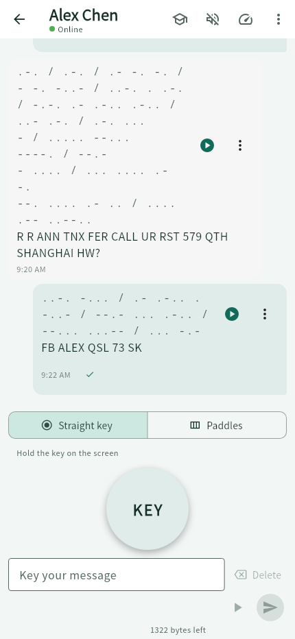
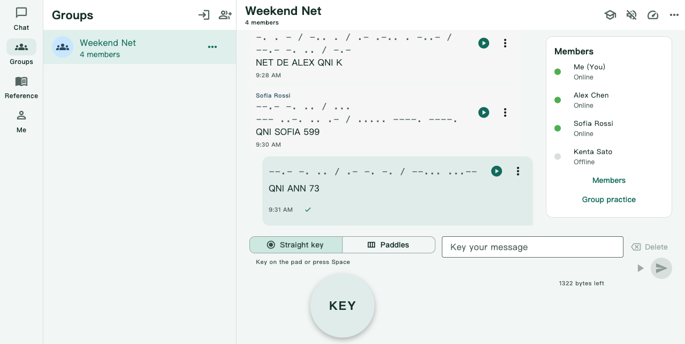

[简体中文](./README.zh-CN.md)

# DitMesh

**Chat in Morse code.** DitMesh is a serverless Morse messenger over the [Tox](https://tox.chat) peer-to-peer network. Key messages with a straight key or iambic paddles, by touch or physical keyboard, in direct conversations and group nets. No phone number, e-mail or central registration is needed: your identity is generated on your device.

For offline Morse learning and practice, use [MorseCQ](https://github.com/agentx-icu/morsecq).

[Install and start chatting](#install-and-start-chatting) · [Build from source](#build-and-run) · [Documentation](doc/README.md)

## Install and start chatting

Choose an asset for your operating system and CPU. Check the release notes for included features and signing details, and use `SHA256SUMS` to verify the download. [GitHub Releases](https://github.com/agentx-icu/ditmesh/releases).

| Platform | Asset to look for |
|---|---|
| macOS 13 or later | `arm64` for Apple silicon and `x86_64` for Intel, in PKG or ZIP format |
| Windows | x64 MSI installer or ZIP bundle |
| Linux | x86_64 DEB for Debian-based systems, RPM for RPM-based systems, or a `.tar.gz` bundle |
| Android | APK for direct installation. AAB is for distribution through a store. |
| iPhone and iPad | The GitHub release provides an unsigned IPA that requires signing and provisioning before installation. |

1. On the welcome screen, select **Create identity** or **Restore from backup**. For a new identity, enter a display name and optionally set an identity password. Follow the backup prompt and keep the file somewhere separate from the device.
2. In **Chat**, open **Your first Morse chat** and select **Try in my self chat**. Key `CQ` (`-.-. --.-`), preview the draft, and send it to yourself. The chat help button reopens the guide.
3. Open **Chat → Contacts**, then scan your friend's QR code or enter their Tox ID. Once the request is accepted, keep both apps running and connected while you send and play back your first message.

If chat stays offline, open **Network and bootstrap** from **Me** or from the welcome/unlock screen and test the selected node. The node guide covers automatic and manual selection, local-network permissions and queued messages. [Bootstrap nodes and LAN hosting](doc/operations/NETWORK.md).

## Features

The main destinations are **Chat / Groups / Reference / Me** on phones, tablets and desktops.

- **Morse-only composing:** touch/keyboard straight key and iambic paddles, read-only decoded draft, Morse preview, pre-listen, correction and byte limit. There is no text-typing chat mode.
- **First conversation:** a dismissible guide opens note-to-self for real keying and listening, then the existing contact/QR flow. Reopen it from Chat's help button.
- **Direct chat:** Tox ID and QR contacts, friend requests, local notes to yourself, unread counts, drafts and persistent history.
- **Group nets:** create, join by group ID, invite, manage members and rejoin after restart. Group messages use the same Morse composer.
- **Playback and practice:** pause/resume, word navigation, word-range repeat/loop, progress and current-word highlighting, with saved per-conversation listening preferences. Choose received original keying rhythm or your own speed/Farnsworth spacing; audio/haptic/flash, listen-first/reveal, listen-only, copy exercises and group practice remain available; structured training (courses, statistics, saved materials) is in MorseCQ.
- **Message management:** history search, filters, jump to result, bookmarks, queued-send cancellation and failed-send retry without duplicate bubbles.
- **Device identity and backups:** password-protected identity, encrypted export with selectable components, restore preview, Tox profile import and current DitMesh backup restore.
- **Privacy and moderation:** peer-to-peer encrypted transport, local notifications, blocked peers and community guidelines. No messaging or push server.
- **Reference and key setup:** alphabet, prosigns, Q-codes, translator, Chinese telegraph-code interpretation and configurable device key bindings.
- **Radio tools:** thirteen offline calculators next to the key: Maidenhead locator with heading and distance, IARU band plan with wire-antenna lengths, power and dB with S-meter equivalents, SWR, feedline loss, L-network matching, LC resonance / attenuator / pad arithmetic, link budget with radio horizon, CW speed timing, RST, sunrise and grey line, the NCDXF beacon schedule and a UTC clock.
- **Network configuration:** official node catalogue, node reachability tests, automatic/manual selection and desktop LAN hosting; network settings also work before unlocking an identity. [Node and LAN guide](doc/operations/NETWORK.md).
- **Location and People nearby.** Opt-in location sharing, grid locator autofill and discovery with compatible Toxee or DitMesh clients. The location guide explains which data goes to conversation recipients or public discovery groups. [Location and People nearby](doc/reference/LOCATION_AND_NEARBY.md).
- **Appearance and languages:** ten interface locales and four styles, Minimal White, Brass Handbook, Night Radio and Fresh Cartoon, with light, dark or system brightness.
- **Desktop integration:** responsive panes, window persistence, tray, unread badge and notification routing.

DitMesh exchanges messages with other Tox clients such as [toxee](https://github.com/agentx-icu/toxee). Open a message's player controls to select a word or range to replay. Playback uses your preferred speed and spacing by default; compatible DitMesh clients also exchange original mark/gap timing. Missing or mismatched timing is explicitly unavailable and uses your speed. Source and speed choices apply to the next replay. Listen-only controls use word numbers without exposing hidden text.

New keyed drafts capture actual timings even with local sidetone disabled. Deleting a keyed token removes its timing; the remaining silence retains the actual gap until the next surviving token. History, offline sends and selected encrypted backup components preserve timing. Restored text-only drafts have no original timing, and an over-limit recording sends as ordinary text.

Automatic mode uses saved or default nodes and refreshes the [official Tox list](https://nodes.tox.chat/) in the background; manual node settings are preserved. Both peers must be running and reachable for delivery. Messages for an offline peer wait in the send queue until the peer reconnects. Keep the app running to receive messages.

Tap an outgoing status icon for details. Queued means stored on this device; sent means accepted by the transport; delivered requires a peer receipt. A group receipt confirms at least one member, and does not imply that everybody has read or listened. Note-to-self is saved locally. Chat's pending-message list includes older queued/failed messages and offers cancellation or retry under the same message ID.

## Screenshots

<table>
<tr><th>Direct chat · phone layout</th><th>Group conversation · macOS</th></tr>
<tr>
<td valign="top"></td>
<td valign="top"></td>
</tr>
</table>

On a phone, open a conversation to start keying. A wide desktop window keeps the list beside the open conversation. A short press on the straight key makes a dot and a longer press makes a dash. Use **Preview draft** to listen before sending and **Delete** to correct the last input. Tap the status icon on a sent message to open **Delivery details**. The conversations shown use demo data.

[Platform screenshot gallery](doc/screenshots/README.md) · [Capture instructions](tool/screenshots/README.md) · [Product design](doc/designs/product-2026-10-08/README.md) · [App icon](doc/designs/icon-2026-10-08/README.md)

## Build and run

The project pins **Flutter 3.41.9 / Dart 3.11.5**. The commands below build and launch the real Tox backend on macOS with Xcode, CocoaPods and CMake installed. The native build selects the current Mac's CPU architecture. Find the Linux, Windows, Android and iOS commands in the [build guide](doc/operations/BUILD_AND_DEPLOY.md#local-builds).

```bash
git clone --recurse-submodules https://github.com/agentx-icu/ditmesh.git
cd ditmesh
dart run tool/bootstrap_deps.dart
dart pub get --enforce-lockfile
bash tool/ci/build_tim2tox.sh --target macos
cd apps/ditmesh
flutter run -d macos
```

For UI development with an in-memory backend, see the [app developer guide](apps/ditmesh/README.md#run). For packaging and signing, see the [distribution and store-readiness matrix](doc/release/STORE_READINESS.md). The real Tox backend requires a native Flutter app on one of the five supported platforms.

## Development checks

After bootstrapping and resolving dependencies at the repository root, run these checks from the root.

```bash
bash tool/test_pyramid.sh --level gates
bash tool/test_pyramid.sh --level unit
bash tool/test_pyramid.sh --level widget
```

These levels cover analysis, source guards, and tests that do not require the native library. See the [test guide](doc/testing/TEST_PYRAMID.md) for device E2E and real Tox peer tests.

## Privacy, support and licence

[Privacy](site/privacy.md) · [Community guidelines](site/terms.md) · [Support](https://github.com/agentx-icu/ditmesh/issues) · [GPL-3.0](LICENSE)
