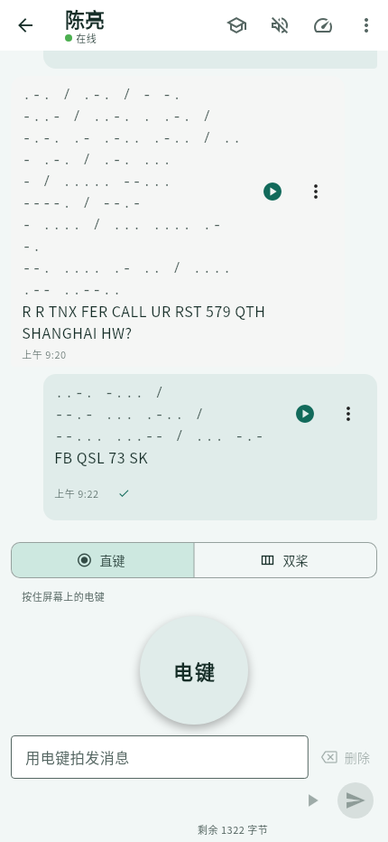
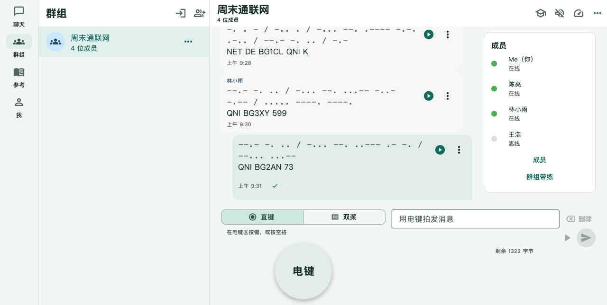

[English](./README.md)

# DitMesh

**用 Morse Code 聊天。** DitMesh 是基于 [Tox](https://tox.chat) 点对点网络、没有聊天服务器的莫尔斯电码聊天应用。通过触摸或物理键盘操作直键、双桨，在单聊和群组中发报。不需要手机号、邮箱或中心服务器注册；身份密钥在设备本地生成。

离线学习和练习 Morse Code，请使用 [MorseCQ](https://github.com/agentx-icu/morsecq)。

[安装并开始聊天](#安装并开始聊天) · [从源码构建](#构建与运行) · [文档索引](doc/README.zh-CN.md)

## 安装并开始聊天

按操作系统和 CPU 架构选择安装包。在发布说明中查看该版本包含的功能与签名信息，并用 `SHA256SUMS` 校验下载文件。见 [GitHub Releases](https://github.com/agentx-icu/ditmesh/releases)。

| 平台 | 安装包 |
|---|---|
| macOS 13 或更高版本 | Apple 芯片选 `arm64`，Intel 选 `x86_64`。可选 PKG 或 ZIP。 |
| Windows | x64 MSI 安装包或 ZIP 压缩包 |
| Linux | Debian 系选 x86_64 DEB，RPM 系选 x86_64 RPM，也可选择 x86_64 `.tar.gz` 压缩包。 |
| Android | 直接安装选 APK。AAB 用于提交应用商店。 |
| iPhone 和 iPad | GitHub 发布的是未签名 IPA，安装前需配置描述文件并签名。 |

1. 在欢迎页选择**创建身份**或**从备份恢复**。新建身份时填写显示名称，可设置身份密码。按提示备份，把备份文件保存在设备之外。
2. 在**聊天**页打开**第一次电码聊天**，点击**在发给自己中试一试**。拍发 `CQ`（`-.-. --.-`），试听草稿，再发给自己。聊天页的帮助按钮可重新打开引导。
3. 打开**聊天 → 联系人**，扫描好友二维码或输入对方的 Tox ID。好友请求获接受后，保持两端应用运行且已连接，再发送和播放第一条消息。

聊天持续离线时，从**我**、欢迎页或解锁页进入**网络与引导节点**，测试已选节点。网络指南涵盖自动和手动选点、局域网权限和待发送队列。见[引导节点与局域网托管](doc/operations/NETWORK.zh-CN.md)。

## 功能

手机、平板和桌面使用 **聊天 / 群组 / 参考 / 我** 四个主入口。

- **只能用 Morse 发消息**：触摸或键盘直键/双桨输入，只读解码草稿、点划预览、发送前试听、纠错与字节限额；没有普通文字键入聊天模式。
- **首次聊天引导**：可关闭的引导带你进入给自己的会话，实际拍发、试听，再进入现有联系人/二维码流程；聊天页帮助按钮可随时重新打开。
- **单聊**：Tox ID 与二维码加好友、好友申请、发给自己的笔记、未读计数、草稿、持久化历史。
- **群聊**：新建、通过群 ID 加入、邀请、成员管理、重启后重入；群消息使用同一套 Morse 输入。
- **播放与练习**：暂停/继续、按词跳转、词段重播/循环、进度和当前词高亮，逐会话保存听音偏好；可选择收到的原始拍发节奏或自己的速度/Farnsworth 间距，支持音频/震动/闪光、先听后揭晓、纯听、抄收练习及群内练习；系统化训练（课程、统计、保存的材料）在 MorseCQ 中。
- **消息管理**：历史搜索、过滤、跳转、书签、取消尚未发送的队列消息、失败重试且不重复创建消息气泡。
- **身份与备份**：身份密码保护、加密导出时可选择组件，恢复前可预览、`.tox` 身份文件导入及 DitMesh 备份恢复。
- **隐私与屏蔽**：点对点加密传输、本地通知、屏蔽联系人及社区准则；没有聊天或推送服务器。
- **参考与电键**：字母、程序信号、Q 简语、译码、中文电报码解读及设备按键配置。
- **无线电工具**：电键旁的十三个离线计算器：Maidenhead 网格与方位距离、IARU 频段表与线天线长度、功率与 dB 换算及 S 表读数、驻波比、馈线损耗、L 型匹配网络、LC 谐振 / 衰减器 / 匹配网络计算、含无线电视距的链路预算、CW 速度时序、RST 报告、日出与灰线、NCDXF 信标时刻表和 UTC 时钟。
- **网络配置**：官方节点目录、节点可达性测试、自动/手动选择、桌面局域网托管；解锁身份前也可设置网络。见[节点与局域网指南](doc/operations/NETWORK.zh-CN.md)。
- 可按需启用**定位与附近的人**，分享位置、自动填写网格定位器，或发现兼容的 Toxee 和 DitMesh 客户端。定位指南说明哪些数据会发给会话接收方，哪些会发到公开发现群。见[定位与附近的人](doc/reference/LOCATION_AND_NEARBY.zh-CN.md)。
- **外观与语言**：十种界面语言，纯白简约、黄铜手册、夜航电台、清新卡通四种风格，可选浅色、深色或跟随系统。
- **桌面体验**：自适应会话面板、窗口记忆、托盘、未读角标和通知跳转。

DitMesh 可与 [toxee](https://github.com/agentx-icu/toxee) 等 Tox 客户端互通。打开消息播放器控制面板可选择单词或词段重播，默认按你选择的速度和间距播放；兼容 DitMesh 客户端还可交换原始按下/间隔时序。缺少或不匹配的记录会明确显示不可用，并使用自己的速度；来源和速度选择在下一次重播生效。纯听模式的控制只显示词序号，不暴露隐藏文字。

新拍发的草稿即使关闭本地侧音也采集真实时序。删除 token 会移除对应片段，保留的静音仍反映到下一个保留 token 之间的实际间隔；历史、离线发送及选中的加密备份组件保留时序。恢复的纯文本草稿没有原始记录，超出记录上限时按普通文字发送。

自动模式使用已保存或默认节点，后台刷新[官方 Tox 列表](https://nodes.tox.chat/)；手动配置保持有效。双方应用都运行且网络可达时才能送达。对方离线时消息保留在待发送队列，恢复连接后继续发送。接收消息时请保持应用运行。

点按自己消息的状态图标可查看详情。“已排队”表示保存在本机，“已发送”表示传输层接受，“已送达”需要对端回执。群聊回执只确认至少一名成员收到，不代表所有人已读或已听；给自己的消息明确显示为本地保存。聊天页的待发送列表包含历史中的排队/失败消息，支持取消或使用同一消息 ID 重试。

## 截图

<table>
<tr><th>单聊 · 手机布局</th><th>群聊 · macOS</th></tr>
<tr>
<td valign="top"></td>
<td valign="top"></td>
</tr>
</table>

在手机上，点开会话即可拍发。桌面窗口够宽时，列表和当前会话会并排显示。短按直键输入点，长按输入划；选**试听草稿**可在发送前听一遍，选**删除**可修正最后一个输入。点按已发消息的状态图标可查看**投递详情**。图中会话使用演示数据。

[中英文平台图库](doc/screenshots/README.zh-CN.md) · [截图采集](tool/screenshots/README.zh-CN.md) · [产品设计](doc/designs/product-2026-10-08/README.zh-CN.md) · [应用图标](doc/designs/icon-2026-10-08/README.zh-CN.md)

## 构建与运行

项目固定使用 **Flutter 3.41.9 / Dart 3.11.5**。以下命令在装有 Xcode、CocoaPods 和 CMake 的 macOS 上构建并启动真实 Tox 后端。原生构建会选用当前 Mac 的 CPU 架构。Linux、Windows、Android 和 iOS 的命令见[构建指南](doc/operations/BUILD_AND_DEPLOY.zh-CN.md#本机构建)。

```bash
git clone --recurse-submodules https://github.com/agentx-icu/ditmesh.git
cd ditmesh
dart run tool/bootstrap_deps.dart
dart pub get --enforce-lockfile
bash tool/ci/build_tim2tox.sh --target macos
cd apps/ditmesh
flutter run -d macos
```

仅开发界面时，可按[应用开发指南](apps/ditmesh/README.zh-CN.md#运行)启动内存后端。打包和签名见[分发与商店准备矩阵](doc/release/STORE_READINESS.zh-CN.md)。真实 Tox 后端需要在上述五个平台之一运行原生 Flutter 应用。

## 开发检查

完成依赖初始化和解析后，从仓库根目录运行以下检查。

```bash
bash tool/test_pyramid.sh --level gates
bash tool/test_pyramid.sh --level unit
bash tool/test_pyramid.sh --level widget
```

这三个层级涵盖静态分析、源码检查和无需加载原生库的测试。设备端到端测试和真实 Tox 节点测试见[测试指南](doc/testing/TEST_PYRAMID.zh-CN.md)。

## 隐私、支持与许可证

[隐私](site/zh-CN/privacy.md) · [社区准则](site/zh-CN/terms.md) · [问题反馈](https://github.com/agentx-icu/ditmesh/issues) · [GPL-3.0](LICENSE)
